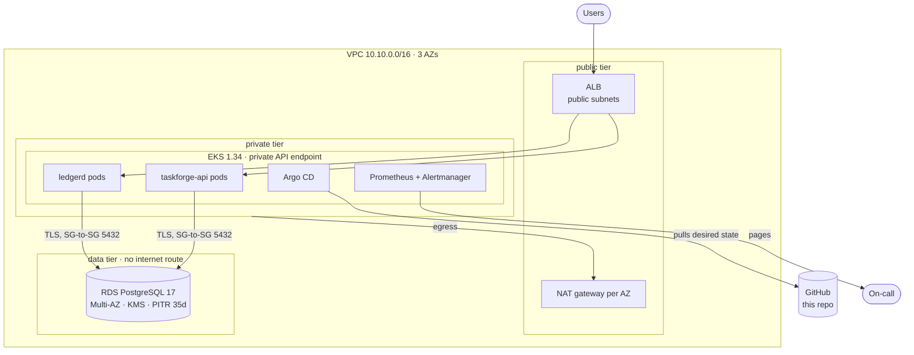
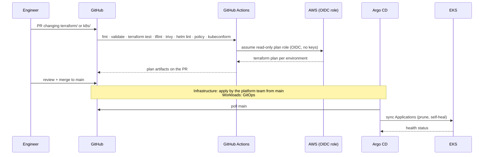

# infra-blueprint

[](https://github.com/jakhongirjp/infra-blueprint/actions/workflows/ci.yml)


Production platform blueprint on AWS: a three-tier VPC, a hardened EKS
cluster, managed PostgreSQL, GitOps delivery with Argo CD and SLO-based
alerting. It is the platform the other services in this portfolio
([ledgerflow](https://github.com/jakhongirjp/ledgerflow),
[taskforge](https://github.com/jakhongirjp/taskforge)) are designed to run on.

Every module is tested with `terraform test` and mocked providers, so CI
proves the security guardrails without an AWS account.

## Architecture



### Delivery flow



## Repository layout

```
terraform/
  bootstrap/            remote-state bucket (versioned, KMS, TLS-only)
  modules/network/      three-tier VPC, per-AZ NAT, S3 endpoint, flow logs
  modules/eks/          EKS with KMS secrets, audit logs, access entries,
                        Pod Identity, IMDSv2-only managed node groups
  modules/postgres/     RDS PostgreSQL with forced TLS, PITR, managed secret,
                        Performance Insights and CloudWatch alarms
  envs/staging|production   compositions with environment-specific sizing
k8s/
  charts/service/       hardened chart every stateless service uses
  argocd/               app-of-apps, AppProject with change-freeze window
  platform/             namespaces (PSS restricted + quotas), SLO alert rules
scripts/                manifest policy checks used in CI
docs/                   ADRs and runbooks
```

## Security baseline

| Layer | Control |
|---|---|
| Network | Data tier has no route out; DB reachable only from the cluster SG; default SG locked; VPC flow logs |
| Cluster | Private API endpoint by default, `0.0.0.0/0` rejected by validation; API auth mode with explicit admin access entries; audit logs; KMS envelope encryption for Secrets |
| Nodes | IMDSv2 only with hop limit 1; encrypted gp3 volumes; SSM instead of SSH |
| Workloads | PSS `restricted`; non-root, read-only rootfs, no privilege escalation, all capabilities dropped; default-deny NetworkPolicy; no auto-mounted SA tokens; Pod Identity for AWS access |
| Data | KMS encryption at rest, `rds.force_ssl=1`, master password managed by Secrets Manager (never in state), IAM DB auth |
| Pipeline | GitHub OIDC to AWS, no static keys; Trivy, tflint and a manifest policy gate on every PR |

Each control that can be asserted is asserted in `terraform test` or
`scripts/check_chart_policy.py`.

## Environments

| | staging | production |
|---|---|---|
| AZs | 2 | 3 |
| NAT | 1 shared | 1 per AZ |
| Nodes | spot `m7i.large` 2–8 | system ×3, general 3–30, spot batch 0–20 |
| PostgreSQL | `db.t4g.medium`, single-AZ, 7-day PITR | `db.r7g.xlarge`, Multi-AZ, 35-day PITR, deletion protection |

## Reliability and disaster recovery

| Scenario | Mechanism | RPO | RTO |
|---|---|---|---|
| Node or pod failure | PDBs, topology spread, HPA | 0 | seconds |
| AZ outage | 3-AZ nodes, per-AZ NAT, Multi-AZ RDS failover | 0 | ~2 min |
| Bad deploy | Argo CD rollback to previous revision | 0 | < 5 min |
| Data corruption | RDS point-in-time restore | ≤ 5 min | ~30–60 min |
| Region loss | Rebuild from Terraform in a second region; cross-region backup replication is planned (M3) | ≤ 24 h once M3 ships | ~4 h |

Procedures: [restore PostgreSQL](docs/runbooks/postgres-point-in-time-restore.md),
[error budget burn](docs/runbooks/error-budget-burn.md),
[rebuild a cluster](docs/runbooks/cluster-rebuild.md).

## Observability

Services expose Prometheus metrics; the chart creates a `ServiceMonitor` for
each. `k8s/platform/slo-alerts.yaml` defines multi-window burn-rate alerts
for a 99.9% availability SLO, the approach from the Google SRE Workbook:
page on fast burn (2% of budget in an hour), open a ticket on slow burn.
RDS has CloudWatch alarms for CPU and free storage, and Performance Insights.

## Usage

```bash
# once per account
cd terraform/bootstrap && terraform init && terraform apply -var state_bucket=acme-tfstate

# each environment
cd terraform/envs/staging
terraform init -backend-config=bucket=acme-tfstate
terraform plan -var 'operator_cidrs=["203.0.113.0/24"]'

# GitOps
kubectl apply -f k8s/argocd/projects/ -f k8s/argocd/root.yaml
```

Local checks, the same as CI:

```bash
for m in terraform/modules/*; do (cd $m && terraform init -backend=false && terraform test); done
helm template t k8s/charts/service -f k8s/charts/service/ci/ledgerflow-values.yaml | scripts/check_chart_policy.py
scripts/render_argocd_apps.sh
```

## Decisions

- [ADR-0001: Plain AWS resources instead of community modules](docs/adr/0001-own-modules.md)
- [ADR-0002: GitOps for workloads, reviewed applies for infrastructure](docs/adr/0002-gitops-boundary.md)
- [ADR-0003: Multi-burn-rate SLO alerts instead of threshold alerts](docs/adr/0003-slo-alerting.md)

## Cost notes

Production's fixed floor is dominated by three NAT gateways, three system
nodes and a Multi-AZ `r7g.xlarge`. Staging trades availability for cost
(one NAT, spot nodes, single-AZ database). The S3 gateway endpoint removes
NAT data charges for image layers and backups.

## Documentation

| Document | Contents |
|---|---|
| [Product](docs/product.md) | Vision, business problem, business and technical requirements, workflows |
| [Engineering](docs/engineering.md) | Boundaries, security, performance, observability, DR, DevOps, testing |
| [Roadmap](docs/roadmap.md) | Ten milestones and the release plan |
| [CTO review checklist](docs/cto-review-checklist.md) | Honest status against production-readiness criteria |
| [ADRs](docs/adr) | Architecture decisions |
| [Contributing](CONTRIBUTING.md) | Branching, commits, labels, board, releases |

## License

MIT
