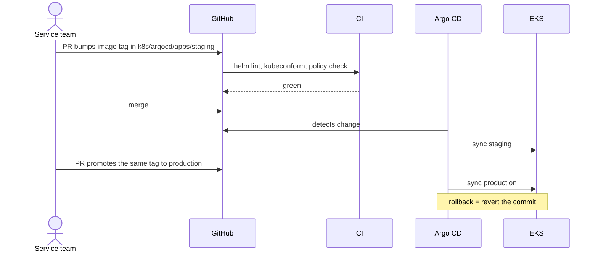

# Product: vision and requirements

## Vision

A new product team should get a production-grade, audited platform on AWS in a
day instead of a quarter. infra-blueprint is that platform as code: network,
Kubernetes, PostgreSQL, a hardened service chart and GitOps delivery, with the
security and reliability controls already decided, tested and documented. Teams
fork it, set a handful of variables and ship.

**Who it's for.** Platform and SRE teams who support several product teams,
and startups preparing for their first SOC 2 or ISO 27001 audit.

## Business problem

| Today | Cost |
|---|---|
| Each team builds infrastructure by hand in the console | Drift, no review trail, outages from one-off changes |
| Security controls added after an audit finding | Rework, delayed enterprise deals |
| No rehearsed recovery | RTO measured in days when a database is corrupted |
| Long-lived cloud keys in CI | The most common root cause of cloud account compromise |

## Business requirements

| ID | Requirement |
|---|---|
| BR-1 | Every infrastructure change is code, reviewed in a pull request and planned before apply. |
| BR-2 | Staging and production are built from the same modules with different sizes. |
| BR-3 | A service team deploys by changing Git, not by holding cluster credentials. |
| BR-4 | Encryption at rest and in transit everywhere, with customer-managed keys for state. |
| BR-5 | Recovery objectives are stated per failure scenario and backed by a runbook. |
| BR-6 | Reliability is managed with SLOs and error budgets, not uptime anecdotes. |

## Technical requirements

| ID | Requirement | How it is met |
|---|---|---|
| TR-1 | Modules tested without a cloud account | `terraform test` with `mock_provider` asserting security properties |
| TR-2 | Safe state | S3 backend with native lockfile, versioning and KMS CMK, created by `bootstrap` |
| TR-3 | No static credentials | GitHub OIDC role for plans; Pod Identity for workloads |
| TR-4 | Workload hardening by default | Chart enforces PSS `restricted`, read-only root FS, default-deny NetworkPolicy; checked by a policy script in CI |
| TR-5 | GitOps | Argo CD app-of-apps with an `AppProject` restricting sources and destinations |
| TR-6 | Alerting on user impact | Multi-window burn-rate alerts for a 99.9% SLO |

## Business workflow: shipping a service change

